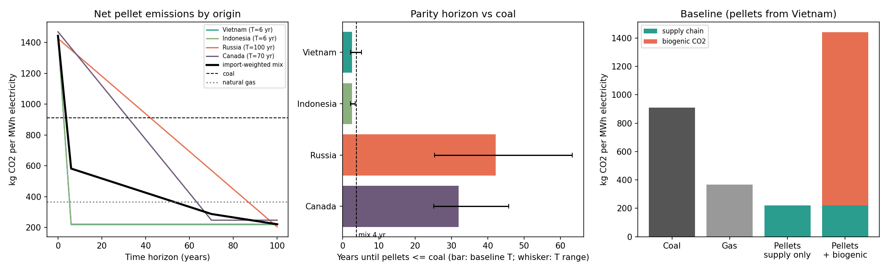

# Biomass carbon model: imported wood pellets for electricity in South Korea

A transparent per-MWh carbon model that compares electricity from imported wood pellets with coal and natural gas. It makes explicit the assumption that decides the result: how fast the forest re-absorbs the CO2 released at the stack.

## Question
How many kg of CO2 does 1 MWh of electricity from imported wood pellets emit over time, compared with coal and natural gas, and which assumptions change the answer most?

## Method
- Per MWh of electricity: fuel energy = 3.6 GJ / plant efficiency.
- Pellets: stack (biogenic) CO2 from the IPCC factor for wood, plus supply-chain emissions (feedstock, pelletising, inland transport, sea transport).
- Biogenic CO2 is re-absorbed linearly over a regrowth time T. The net emission after a time horizon H is supply chain + biogenic x max(0, 1 - H/T).
- Coal and gas: combustion emissions only (upstream emissions are not included, which favours coal and gas).
- Parity horizon: the time H after which pellet electricity emits no more than coal.

## Main inputs and sources
| Parameter | Value | Source |
|---|---|---|
| CO2 factor, wood | 112 kg/GJ (95-132) | IPCC 2006 Guidelines, Vol. 2, Table 2.2 |
| CO2 factor, sub-bituminous coal | 96.1 kg/GJ | same |
| CO2 factor, natural gas | 56.1 kg/GJ | same |
| Pelletising | 160 kg CO2e/t | Jonker, Junginger, Faaij (2014), GCB Bioenergy 6:371 |
| Feedstock (silviculture) | 78 kg CO2e/t (30-96) | same |
| Truck 100 km + rail | 71 kg CO2e/t | same |
| Sea transport | 0.008 kg CO2/t-km (0.0027-0.013) | assumption; lower bound GLEC Framework v3.0 (2023), bulk carrier >200,000 dwt |
| Sea distances | Russia 1000, Vietnam 4000, Indonesia 4500, Canada 9500 km | approximate estimates |
| Pellet heating value | 17 GJ/t | assumption (typical range 16-18) |
| Efficiency | pellets 33 %, coal 38 %, gas 55 % | assumptions, varied in sensitivity |
| Regrowth time | 30 years (5-100) | assumption; see Jonker et al. for payback ranges |

Context: Korea imported about 3.9 million tonnes of wood pellets in 2025, mainly from Vietnam (37 %), Indonesia (23 %), Russia (16 %) and Canada (12 %) (Lesprom news report).

## Results (baseline, pellets from Vietnam)

| Case | kg CO2 per MWh |
|---|---|
| Coal | 910 |
| Natural gas | 367 |
| Pellets, supply chain only | 219 |
| Pellets, biogenic CO2 at stack | 1222 |
| Pellets, supply chain + all biogenic | 1441 |

Pellet electricity emits less than coal after about 2, 13, 26 and 43 years for regrowth times of 5, 30, 60 and 100 years. The origin (1000-9500 km of sea transport) changes the parity time by only about 1-4 years; regrowth time and plant efficiency matter most.

## Limitations
- Linear regrowth is a simplification; the real forest carbon response depends on forest type, management and the counterfactual (no harvest, or residues that would decay).
- Land-use change, soil carbon, methane and N2O are not included.
- Coal and gas upstream emissions are not included.
- Distances, sea-transport factor, heating value and efficiencies are assumptions, not measured values for specific Korean plants.
- Results are model estimates and not validated against plant data.

## Run
```
pip install -r requirements.txt
python model.py
```
Outputs: `results/baseline.csv`, `results/parity_horizon.csv`, `results/sensitivity.csv`, `results/biomass_carbon.png`.
